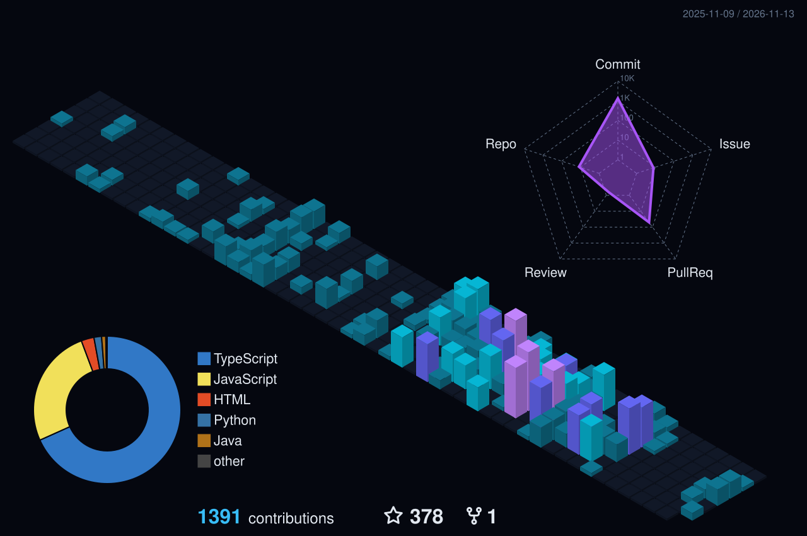

<div align="center">


<a href="https://github.com/GitAlboBis"></a>

```aura inline align=center link="https://linkedin.com/in/albertotuveri" width=196 height=44
<SocialMediaButton
  icon="data:image/svg+xml;base64,PHN2ZyB4bWxucz0iaHR0cDovL3d3dy53My5vcmcvMjAwMC9zdmciIHZpZXdCb3g9IjAgMCAyNCAyNCIgZmlsbD0iI2ZmZmZmZiI+PHBhdGggZD0iTTIwLjQ1IDIwLjQ1aC0zLjU2di01LjU3YzAtMS4zMy0uMDItMy4wNC0xLjg1LTMuMDQtMS44NSAwLTIuMTQgMS40NS0yLjE0IDIuOTR2NS42N0g5LjM1VjloMy40MXYxLjU2aC4wNWMuNDgtLjkgMS42NC0xLjg1IDMuMzctMS44NSAzLjYgMCA0LjI3IDIuMzcgNC4yNyA1LjQ2djYuMjh6TTUuMzQgNy40M2EyLjA2IDIuMDYgMCAxIDEgMC00LjEzIDIuMDYgMi4wNiAwIDAgMSAwIDQuMTN6TTcuMTIgMjAuNDVIMy41NlY5aDMuNTZ2MTEuNDV6TTIyLjIyIDBIMS43N0MuNzkgMCAwIC43NyAwIDEuNzN2MjAuNTRDMCAyMy4yMy43OSAyNCAxLjc3IDI0aDIwLjQ1Yy45OCAwIDEuNzgtLjc3IDEuNzgtMS43M1YxLjczQzI0IC43NyAyMy4yIDAgMjIuMjIgMHoiLz48L3N2Zz4="
  text="in/albertotuveri"
  backgroundColor="#070a14"
  textColor="#f1f5f9"
  borderColor="#1e293b"
  fontSize={14}
  width={196}
  height={44}
  iconSize={18}
  gradientStrokeWidth={1.6}
  gradientStops={[
    { offset: '0%', color: '#38bdf8' },
    { offset: '20%', color: '#0b1020' },
    { offset: '50%', color: '#0a66c2' },
    { offset: '62%', color: '#ffffff' },
    { offset: '80%', color: '#0b1020' },
    { offset: '100%', color: '#38bdf8' },
  ]}
/>
```

```aura inline align=center link="mailto:albertotuveri@gmail.com" width=246 height=44
<SocialMediaButton
  icon="data:image/svg+xml;base64,PHN2ZyB4bWxucz0iaHR0cDovL3d3dy53My5vcmcvMjAwMC9zdmciIHZpZXdCb3g9IjAgMCAyNCAyNCIgZmlsbD0ibm9uZSIgc3Ryb2tlPSIjNjdlOGY5IiBzdHJva2Utd2lkdGg9IjEuOCIgc3Ryb2tlLWxpbmVjYXA9InJvdW5kIiBzdHJva2UtbGluZWpvaW49InJvdW5kIj48cmVjdCB4PSIyLjUiIHk9IjQuNSIgd2lkdGg9IjE5IiBoZWlnaHQ9IjE1IiByeD0iMi41Ii8+PHBhdGggZD0ibTMgNi41IDkgNi41IDktNi41Ii8+PC9zdmc+"
  text="albertotuveri@gmail.com"
  backgroundColor="#070a14"
  textColor="#f1f5f9"
  borderColor="#1e293b"
  fontSize={14}
  width={246}
  height={44}
  iconSize={18}
  gradientStrokeWidth={1.6}
  gradientStops={[
    { offset: '0%', color: '#22d3ee' },
    { offset: '20%', color: '#0b1020' },
    { offset: '50%', color: '#67e8f9' },
    { offset: '62%', color: '#ffffff' },
    { offset: '80%', color: '#0b1020' },
    { offset: '100%', color: '#22d3ee' },
  ]}
/>
```

```aura inline align=center link="https://sersan.io" width=150 height=44
<SocialMediaButton
  icon="data:image/svg+xml;base64,PHN2ZyB4bWxucz0iaHR0cDovL3d3dy53My5vcmcvMjAwMC9zdmciIHZpZXdCb3g9IjAgMCAyNCAyNCIgZmlsbD0ibm9uZSIgc3Ryb2tlPSIjYzRiNWZkIiBzdHJva2Utd2lkdGg9IjEuOCIgc3Ryb2tlLWxpbmVqb2luPSJyb3VuZCI+PHBhdGggZD0iTTEyIDIuNSAyMC4yIDcuMjV2OS41TDEyIDIxLjUgMy44IDE2Ljc1di05LjV6Ii8+PHBhdGggZD0iTTguNiAxNS42IDEyIDcuNmwzLjQgOE05LjkgMTIuOGg0LjIiIHN0cm9rZS1saW5lY2FwPSJyb3VuZCIvPjwvc3ZnPg=="
  text="sersan.io"
  backgroundColor="#070a14"
  textColor="#f1f5f9"
  borderColor="#1e293b"
  fontSize={14}
  width={150}
  height={44}
  iconSize={18}
  gradientStrokeWidth={1.6}
  gradientStops={[
    { offset: '0%', color: '#a855f7' },
    { offset: '20%', color: '#0b1020' },
    { offset: '50%', color: '#c4b5fd' },
    { offset: '62%', color: '#ffffff' },
    { offset: '80%', color: '#0b1020' },
    { offset: '100%', color: '#a855f7' },
  ]}
/>
```

```aura inline align=center link="https://spherenode.com" width=186 height=44
<SocialMediaButton
  icon="data:image/svg+xml;base64,PHN2ZyB4bWxucz0iaHR0cDovL3d3dy53My5vcmcvMjAwMC9zdmciIHZpZXdCb3g9IjAgMCAyNCAyNCIgZmlsbD0ibm9uZSIgc3Ryb2tlPSIjNmVlN2I3IiBzdHJva2Utd2lkdGg9IjEuOCI+PGNpcmNsZSBjeD0iMTIiIGN5PSIxMiIgcj0iOSIvPjxlbGxpcHNlIGN4PSIxMiIgY3k9IjEyIiByeD0iOSIgcnk9IjMuNiIvPjxwYXRoIGQ9Ik0xMiAzYTEzIDEzIDAgMCAxIDAgMThNMTIgM2ExMyAxMyAwIDAgMCAwIDE4Ii8+PC9zdmc+"
  text="spherenode.com"
  backgroundColor="#070a14"
  textColor="#f1f5f9"
  borderColor="#1e293b"
  fontSize={14}
  width={186}
  height={44}
  iconSize={18}
  gradientStrokeWidth={1.6}
  gradientStops={[
    { offset: '0%', color: '#10b981' },
    { offset: '20%', color: '#0b1020' },
    { offset: '50%', color: '#6ee7b7' },
    { offset: '62%', color: '#ffffff' },
    { offset: '80%', color: '#0b1020' },
    { offset: '100%', color: '#10b981' },
  ]}
/>
```


</div>

<p align="center"></p>

## ⚡ `whoami`

<p align="center">
  
</p>

<sub>↻ Card rigenerata ogni giorno da GitHub Actions con dati live dall'API GraphQL (repos, stars, contributions, commits).</sub>

<p align="center"></p>

## 📊 Production Impact

<p align="center">
  
</p>

<table width="100%">
  <tr>
    <td width="50%" valign="top">
      <h3>🧠 Sphere AI — Bilingual RAG Mentor</h3>
      <p><em>Live at <a href="https://spherenode.com">spherenode.com</a> · SerSan Flagship Vertical SaaS</em></p>
      <ul>
        <li>🔬 <b>100% Citation Correctness</b> across a 161-question bilingual (IT/EN) evaluation benchmark with <b>0 fabricated citations</b> and <b>0 locked-content leaks</b>.</li>
        <li>📈 Boosted clarification precision <b>75% → 94%</b>, recall <b>32% → 90%</b>, answer-policy accuracy <b>52% → 68%</b>, and slashed unsupported claims <b>1.9% → 0.6%</b>.</li>
        <li>🛡️ Engineered deterministic state-machine billing pipelines & closed <b>6 critical access-control vulnerabilities</b> + <b>33 security audit findings</b> pre-launch.</li>
      </ul>
    </td>
    <td width="50%" valign="top">
      <h3>🌌 Real-Time WebGPU & Compute Shaders</h3>
      <p><em>Live at <a href="https://sersan.io">sersan.io</a> & Personal Cinematic Portfolio</em></p>
      <ul>
        <li>⚡ <b>120,000-Particle GPU Fluid Simulation</b> written directly against the WebGPU API (WGSL) forming a living letter <code>'A'</code> with real-time refraction, caustics & sun glints.</li>
        <li>🎬 <b>17 Scroll-Locked 3D Scenes</b> on a single continuous WebGPU canvas: <b>48k-particle</b> wordmark intro, <b>80k-cell</b> depth-lit portrait morph & raymarched black hole.</li>
        <li>🏆 <b>Lighthouse 100 Accessibility & 100 SEO</b> with dynamic mobile GPU device-tiering, automatic WebGL fallback & context-loss recovery.</li>
      </ul>
    </td>
  </tr>
  <tr>
    <td width="50%" valign="top">
      <h3>🏭 Maintech OMA — Heavy-Vehicle ERP</h3>
      <p><em>Enterprise Workshop ERP (~50 Staff · 5 Departments)</em></p>
      <ul>
        <li>🔒 <b>Database-First Zero-Bypass Security:</b> 9 roles, default-deny RLS on every table in PostgreSQL 17, per-site segregation, verified via automated <code>pgTAP</code> test suites.</li>
        <li>⚙️ <b>6-Phase Concurrency-Safe State Machine</b> for job orders, multi-supplier connector console across <b>10 trade portals</b>, and custom <em>"Diesel & Safety"</em> design system.</li>
      </ul>
    </td>
    <td width="50%" valign="top">
      <h3>🌍 Badante 24h & Domus Tua Platforms</h3>
      <p><em>Geospatial Home-Care PWA & Luxury Real-Estate Storytelling</em></p>
      <ul>
        <li>🗺️ <b>Sub-Second Geospatial Matching</b> powered by <b>PostGIS 3</b> (GIST indexes, WGS-84 geography), Leaflet & open-source geocoding (Photon + Nominatim).</li>
        <li>🚀 Cut real-device mobile LCP from <b>4.75s → 1.74s (-63%)</b> and Total Blocking Time from <b>572ms → 274ms (-52%)</b> with full offline Service Worker (Serwist) & VAPID Web Push.</li>
      </ul>
    </td>
  </tr>
</table>

<p align="center"></p>

## 🛠️ Arsenal

<div align="center">

### 🌌 3D Graphics, WebGPU Shaders & Motion Design
<p>
  
  
  
  
  
  
  
</p>

### 🧠 Artificial Intelligence, RAG & Agentic Security
<p>
  
  
  
  
  
</p>

### 💻 Core Languages, Full-Stack, Database & DevSecOps
<a href="https://skillicons.dev">
  
</a>

<p>
  
  
  
  
  
</p>

</div>

<p align="center"></p>

## 📈 GitHub Telemetry

<div align="center">



<br/>

<a href="https://github.com/GitAlboBis"></a>

<br/>

<picture>
  <source media="(prefers-color-scheme: dark)" srcset="https://raw.githubusercontent.com/GitAlboBis/GitAlboBis/output/github-contribution-grid-snake-dark.svg" />
  <source media="(prefers-color-scheme: light)" srcset="https://raw.githubusercontent.com/GitAlboBis/GitAlboBis/output/github-contribution-grid-snake.svg" />
  
</picture>

</div>

<p align="center"></p>

<div align="center">

### 🤝 Let's build the extraordinary

Zero-leak RAG & agentic systems · real-time WebGPU compute shaders · cinematic 3D web experiences.

<a href="mailto:albertotuveri@gmail.com"></a>
<a href="https://linkedin.com/in/albertotuveri"></a>


</div>
