<div align="center">

```aura width=900 height=320
<div style={{
  display: 'flex',
  flexDirection: 'column',
  justifyContent: 'space-between',
  width: '100%',
  height: '100%',
  padding: '36px 42px',
  background: 'linear-gradient(135deg, #050816 0%, #0f172a 55%, #1e1b4b 100%)',
  borderRadius: '24px',
  border: '1px solid rgba(56, 189, 248, 0.28)',
  color: '#f8fafc',
  fontFamily: 'Inter',
  position: 'relative',
  overflow: 'hidden'
}}>
  <style>{`
    @keyframes pulseGlow {
      0%, 100% { opacity: 0.35; transform: scale(1); }
      50% { opacity: 0.85; transform: scale(1.08); }
    }
    @keyframes scanline {
      0% { transform: translateY(-100%); }
      100% { transform: translateY(320px); }
    }
    @keyframes blinkDot {
      0%, 100% { opacity: 1; }
      50% { opacity: 0.25; }
    }
    #aura-orb { animation: pulseGlow 4s ease-in-out infinite; }
    #live-dot { animation: blinkDot 1.6s ease-in-out infinite; }
  `}</style>

  <div style={{ display: 'flex', justifyContent: 'space-between', alignItems: 'center', width: '100%' }}>
    <div style={{
      display: 'flex',
      alignItems: 'center',
      gap: '10px',
      padding: '6px 14px',
      borderRadius: '999px',
      background: 'rgba(6, 182, 212, 0.12)',
      border: '1px solid rgba(6, 182, 212, 0.4)',
      fontSize: '12px',
      letterSpacing: '1.5px',
      color: '#38bdf8',
      fontWeight: 700
    }}>
      <svg width="10" height="10" viewBox="0 0 10 10">
        <circle id="live-dot" cx="5" cy="5" r="4" fill="#10b981" />
      </svg>
      SYSTEM ONLINE // SERSAN AI STUDIO · UNITRENTO M.SC. AI
    </div>
    <div style={{ fontSize: '13px', color: '#94a3b8', fontWeight: 600 }}>
      github.com/GitAlboBis · v2026.11
    </div>
  </div>

  <div style={{ display: 'flex', flexDirection: 'column', gap: '8px', marginTop: '8px' }}>
    <div style={{
      fontSize: '46px',
      fontWeight: 800,
      letterSpacing: '-1px',
      background: 'linear-gradient(90deg, #ffffff 0%, #38bdf8 55%, #a855f7 100%)',
      backgroundClip: 'text',
      color: '#ffffff'
    }}>
      Alberto Tuveri
    </div>
    <div style={{ fontSize: '19px', color: '#cbd5e1', fontWeight: 500 }}>
      Software & AI Engineer · Creative Lead · Full-Stack · WebGPU / 3D & Motion
    </div>
    <div style={{ fontSize: '14px', color: '#94a3b8', maxWidth: '780px', lineHeight: 1.5 }}>
      Architecting deterministic RAG pipelines & Zero-Trust agentic guardrails, database-first security models, and real-time 120k-particle WebGPU compute shaders.
    </div>
  </div>

  <div style={{ display: 'flex', gap: '14px', marginTop: '14px' }}>
    <div style={{
      display: 'flex',
      flexDirection: 'column',
      padding: '10px 16px',
      borderRadius: '12px',
      background: 'rgba(15, 23, 42, 0.78)',
      border: '1px solid rgba(99, 102, 241, 0.35)'
    }}>
      <span style={{ fontSize: '11px', color: '#94a3b8', textTransform: 'uppercase' }}>Sphere AI RAG Citations</span>
      <span style={{ fontSize: '20px', fontWeight: 800, color: '#38bdf8' }}>100% Validated</span>
    </div>
    <div style={{
      display: 'flex',
      flexDirection: 'column',
      padding: '10px 16px',
      borderRadius: '12px',
      background: 'rgba(15, 23, 42, 0.78)',
      border: '1px solid rgba(16, 185, 129, 0.35)'
    }}>
      <span style={{ fontSize: '11px', color: '#94a3b8', textTransform: 'uppercase' }}>WebGPU Compute Fluid</span>
      <span style={{ fontSize: '20px', fontWeight: 800, color: '#10b981' }}>120,000 Particles</span>
    </div>
    <div style={{
      display: 'flex',
      flexDirection: 'column',
      padding: '10px 16px',
      borderRadius: '12px',
      background: 'rgba(15, 23, 42, 0.78)',
      border: '1px solid rgba(168, 85, 247, 0.35)'
    }}>
      <span style={{ fontSize: '11px', color: '#94a3b8', textTransform: 'uppercase' }}>sersan.io 3D Canvas</span>
      <span style={{ fontSize: '20px', fontWeight: 800, color: '#c084fc' }}>17 Scroll Scenes</span>
    </div>
    <div style={{
      display: 'flex',
      flexDirection: 'column',
      padding: '10px 16px',
      borderRadius: '12px',
      background: 'rgba(15, 23, 42, 0.78)',
      border: '1px solid rgba(244, 63, 94, 0.35)'
    }}>
      <span style={{ fontSize: '11px', color: '#94a3b8', textTransform: 'uppercase' }}>Security Hardening</span>
      <span style={{ fontSize: '20px', fontWeight: 800, color: '#fb7185' }}>33 Audits Closed</span>
    </div>
  </div>
</div>
```

<br/>

```aura inline align=center link="https://linkedin.com/in/albertotuveri" width=210 height=46
<div style={{
  display: 'flex',
  alignItems: 'center',
  justifyContent: 'center',
  width: '100%',
  height: '100%',
  borderRadius: '12px',
  background: 'linear-gradient(90deg, #0a66c2, #1d4ed8)',
  color: '#ffffff',
  fontWeight: 700,
  fontSize: '14px',
  letterSpacing: '0.5px'
}}>
  in / albertotuveri
</div>
```

```aura inline align=center link="mailto:albertotuveri@gmail.com" width=240 height=46
<div style={{
  display: 'flex',
  alignItems: 'center',
  justifyContent: 'center',
  width: '100%',
  height: '100%',
  borderRadius: '12px',
  background: 'linear-gradient(90deg, #0f172a, #1e293b)',
  border: '1px solid rgba(56, 189, 248, 0.45)',
  color: '#38bdf8',
  fontWeight: 700,
  fontSize: '14px'
}}>
  albertotuveri@gmail.com
</div>
```

```aura inline align=center link="https://sersan.io" width=180 height=46
<div style={{
  display: 'flex',
  alignItems: 'center',
  justifyContent: 'center',
  width: '100%',
  height: '100%',
  borderRadius: '12px',
  background: 'linear-gradient(90deg, #4f46e5, #7c3aed)',
  color: '#ffffff',
  fontWeight: 700,
  fontSize: '14px'
}}>
  sersan.io 3D ↗
</div>
```

```aura inline align=center link="https://spherenode.com" width=200 height=46
<div style={{
  display: 'flex',
  alignItems: 'center',
  justifyContent: 'center',
  width: '100%',
  height: '100%',
  borderRadius: '12px',
  background: 'linear-gradient(90deg, #059669, #0d9488)',
  color: '#ffffff',
  fontWeight: 700,
  fontSize: '14px'
}}>
  spherenode.com ↗
</div>
```

<br/>

```aura width=900 height=280
<div style={{
  display: 'flex',
  gap: '20px',
  width: '100%',
  height: '100%',
  padding: '24px',
  background: '#090d16',
  borderRadius: '20px',
  border: '1px solid rgba(148, 163, 184, 0.18)',
  color: '#f8fafc',
  fontFamily: 'Inter'
}}>
  <div style={{
    display: 'flex',
    flexDirection: 'column',
    justifyContent: 'space-between',
    width: '48%',
    padding: '20px',
    borderRadius: '16px',
    background: 'rgba(15, 23, 42, 0.9)',
    border: '1px solid rgba(56, 189, 248, 0.25)'
  }}>
    <div style={{ fontSize: '13px', color: '#38bdf8', fontWeight: 700, letterSpacing: '1px' }}>
      AI & RAG ENGINEERING BENCHMARKS // SPHERE AI
    </div>
    <div style={{ display: 'flex', flexDirection: 'column', gap: '10px' }}>
      <div style={{ display: 'flex', justifyContent: 'space-between', fontSize: '13px' }}>
        <span style={{ color: '#cbd5e1' }}>Citation Correctness (0 Hallucinations)</span>
        <span style={{ color: '#10b981', fontWeight: 700 }}>100%</span>
      </div>
      <div style={{ width: '100%', height: '8px', background: '#1e293b', borderRadius: '4px', display: 'flex' }}>
        <div style={{ width: '100%', height: '8px', background: 'linear-gradient(90deg, #06b6d4, #10b981)', borderRadius: '4px' }} />
      </div>

      <div style={{ display: 'flex', justifyContent: 'space-between', fontSize: '13px' }}>
        <span style={{ color: '#cbd5e1' }}>Clarification Precision (75% → 94%)</span>
        <span style={{ color: '#38bdf8', fontWeight: 700 }}>94%</span>
      </div>
      <div style={{ width: '100%', height: '8px', background: '#1e293b', borderRadius: '4px', display: 'flex' }}>
        <div style={{ width: '94%', height: '8px', background: 'linear-gradient(90deg, #3b82f6, #38bdf8)', borderRadius: '4px' }} />
      </div>

      <div style={{ display: 'flex', justifyContent: 'space-between', fontSize: '13px' }}>
        <span style={{ color: '#cbd5e1' }}>Clarification Recall (32% → 90%)</span>
        <span style={{ color: '#a855f7', fontWeight: 700 }}>90%</span>
      </div>
      <div style={{ width: '100%', height: '8px', background: '#1e293b', borderRadius: '4px', display: 'flex' }}>
        <div style={{ width: '90%', height: '8px', background: 'linear-gradient(90deg, #6366f1, #a855f7)', borderRadius: '4px' }} />
      </div>
    </div>
    <div style={{ fontSize: '11px', color: '#64748b' }}>
      Evaluated on 161-question bilingual (IT/EN) test suite · pgvector + LLM relevance grader
    </div>
  </div>

  <div style={{
    display: 'flex',
    flexDirection: 'column',
    justifyContent: 'space-between',
    width: '52%',
    padding: '20px',
    borderRadius: '16px',
    background: 'rgba(15, 23, 42, 0.9)',
    border: '1px solid rgba(168, 85, 247, 0.25)'
  }}>
    <div style={{ fontSize: '13px', color: '#c084fc', fontWeight: 700, letterSpacing: '1px' }}>
      ARCHITECTURAL PILLARS & RESEARCH
    </div>
    <div style={{ display: 'flex', flexDirection: 'column', gap: '8px', fontSize: '13px', color: '#e2e8f0' }}>
      <div>⚡ <b>WebGPU & Shaders:</b> 48k particle wordmark, 80k depth-lit morph, raymarched black hole.</div>
      <div>🛡️ <b>Database-First Security:</b> 9-role Postgres 17 RLS + pgTAP testing & 6-phase state machines.</div>
      <div>🌍 <b>Geospatial & Mobile Perf:</b> PostGIS 3 sub-second search · LCP 4.75s → 1.74s (-63%).</div>
      <div>🎓 <b>Agentic AI Security Thesis:</b> MCP, MITRE ATLAS, OWASP Agentic Top 10 & Zero-Trust.</div>
    </div>
    <div style={{ fontSize: '11px', color: '#64748b' }}>
      B.Sc. Computer Science @ UniCam (2026) · M.Sc. Artificial Intelligence Systems @ UniTrento
    </div>
  </div>
</div>
```

</div>

<br/>

<div align="center">

<!-- ═══════════════════════════════════════════════════════════════════════════
     HERO ANIMATED BANNER (CAPSULE RENDER + CUSTOM SVG HUD)
     ═══════════════════════════════════════════════════════════════════════════ -->
<picture>
  <source media="(prefers-color-scheme: dark)" srcset="https://capsule-render.vercel.app/api?type=venom&color=0:050816,35:0f172a,70:4f46e5,100:06b6d4&height=220&section=header&text=ALBERTO%20TUVERI&fontSize=54&fontColor=ffffff&animation=twinkling&fontAlignY=42&desc=Software%20%26%20AI%20Engineer%20%E2%9A%A1%20Creative%20Lead%20%E2%9A%A1%20WebGPU%20%2F%203D%20%26%20Motion&descAlignY=68&descSize=18" />
  <source media="(prefers-color-scheme: light)" srcset="https://capsule-render.vercel.app/api?type=venom&color=0:0f172a,40:312e81,75:4f46e5,100:0891b2&height=220&section=header&text=ALBERTO%20TUVERI&fontSize=54&fontColor=ffffff&animation=twinkling&fontAlignY=42&desc=Software%20%26%20AI%20Engineer%20%E2%9A%A1%20Creative%20Lead%20%E2%9A%A1%20WebGPU%20%2F%203D%20%26%20Motion&descAlignY=68&descSize=18" />
  
</picture>

<!-- ═══════════════════════════════════════════════════════════════════════════
     DYNAMIC MULTI-LINE TYPING TERMINAL
     ═══════════════════════════════════════════════════════════════════════════ -->
<a href="https://github.com/GitAlboBis">
  
</a>

<br/>

<!-- ═══════════════════════════════════════════════════════════════════════════
     LIVE STATUS & SOCIAL PILLS
     ═══════════════════════════════════════════════════════════════════════════ -->
<p align="center">
  <a href="https://sersan.io" target="_blank">
    
  </a>
  <a href="https://www.unitn.it/" target="_blank">
    
  </a>
  <a href="https://www.unicam.it/" target="_blank">
    
  </a>
</p>

<p align="center">
  <a href="https://linkedin.com/in/albertotuveri" target="_blank">
    
  </a>
  <a href="mailto:albertotuveri@gmail.com">
    
  </a>
  <a href="https://sersan.io" target="_blank">
    
  </a>
  <a href="https://spherenode.com" target="_blank">
    
  </a>
  
</p>

<!-- ═══════════════════════════════════════════════════════════════════════════
     CUSTOM ANIMATED SVG HERO HUD (LOCAL ASSET)
     ═══════════════════════════════════════════════════════════════════════════ -->


</div>

---

## ⚡ `whoami` // Engineering Where Silicon Meets Cinema

```yaml
identity:
  name: "Alberto Tuveri (AlboOnTop)"
  handle: "@GitAlboBis"
  location: "Trento / Marche / Sardinia, Italy 🇮🇹 · Working Globally (London Remote 🇬🇧)"
  current_roles:
    - "Software & AI Engineer · Creative Lead @ SerSan (Sersan Limited, London)"
    - "Full-Stack Architect (Freelance) @ ALS MCL Civitanova"
    - "M.Sc. Candidate in Artificial Intelligence Systems @ University of Trento"
  education:
    msc: "M.Sc. in Artificial Intelligence Systems — University of Trento (2026–Present)"
    bsc: "B.Sc. in Computer Science — University of Camerino (2022–2026)"
    thesis: "From Autocomplete to Agentic Orchestration: Architectural Analysis & Security of OS-Level Agents"

core_superpowers:
  ai_engineering:    ["Production Bilingual RAG", "pgvector", "LLM Evals & Relevance Graders", "Zero-Trust Agentic Guardrails", "MCP"]
  gpu_and_motion:    ["WebGPU", "WGSL / TSL Compute Shaders", "Three.js / R3F", "GLSL Raymarching", "GSAP + Lenis", "4K VFX & Brand Film"]
  fullstack_and_db:  ["Next.js 16 / React 19", "TypeScript Strict", "Supabase / Postgres 17", "PostGIS 3", "RLS & pgTAP Security", "Java Spring Boot"]
```

---

## 📊 Production Impact & Telemetry Bento

<div align="center">
  
</div>

<br/>

<table width="100%">
  <tr>
    <td width="50%" valign="top">
      <h3>🧠 Sphere AI — Bilingual RAG Mentor</h3>
      <p><em>Live at <a href="https://spherenode.com">spherenode.com</a> · SerSan Flagship Vertical SaaS</em></p>
      <ul>
        <li>🔬 <b>100% Citation Correctness</b> across a 161-question bilingual (IT/EN) evaluation benchmark with <b>0 fabricated citations</b> and <b>0 locked-content leaks</b>.</li>
        <li>📈 Boosted clarification precision <b>75% → 94%</b>, recall <b>32% → 90%</b>, answer-policy accuracy <b>52% → 68%</b>, and slashed unsupported claims <b>1.9% → 0.6%</b>.</li>
        <li>🛡️ Engineered deterministic state-machine billing pipelines & closed <b>6 critical access-control vulnerabilities</b> + <b>33 security audit findings</b> pre-launch.</li>
      </ul>
    </td>
    <td width="50%" valign="top">
      <h3>🌌 Real-Time WebGPU & Compute Shaders</h3>
      <p><em>Live at <a href="https://sersan.io">sersan.io</a> & Personal Cinematic Portfolio</em></p>
      <ul>
        <li>⚡ <b>120,000-Particle GPU Fluid Simulation</b> written directly against the WebGPU API (WGSL) forming a living letter <code>'A'</code> with real-time refraction, caustics & sun glints.</li>
        <li>🎬 <b>17 Scroll-Locked 3D Scenes</b> on a single continuous WebGPU canvas: <b>48k-particle</b> wordmark intro, <b>80k-cell</b> depth-lit portrait morph & raymarched black hole.</li>
        <li>🏆 <b>Lighthouse 100 Accessibility & 100 SEO</b> with dynamic mobile GPU device-tiering, automatic WebGL fallback & context-loss recovery.</li>
      </ul>
    </td>
  </tr>
  <tr>
    <td width="50%" valign="top">
      <h3>🏭 Maintech OMA — Heavy-Vehicle ERP</h3>
      <p><em>Enterprise Workshop ERP (~50 Staff · 5 Departments)</em></p>
      <ul>
        <li>🔒 <b>Database-First Zero-Bypass Security:</b> 9 roles, default-deny RLS on every table in PostgreSQL 17, per-site segregation, verified via automated <code>pgTAP</code> test suites.</li>
        <li>⚙️ <b>6-Phase Concurrency-Safe State Machine</b> for job orders, multi-supplier connector console across <b>10 trade portals</b>, and custom <em>"Diesel & Safety"</em> design system.</li>
      </ul>
    </td>
    <td width="50%" valign="top">
      <h3>🌍 Badante 24h & Domus Tua Platforms</h3>
      <p><em>Geospatial Home-Care PWA & Luxury Real-Estate Storytelling</em></p>
      <ul>
        <li>🗺️ <b>Sub-Second Geospatial Matching</b> powered by <b>PostGIS 3</b> (GIST indexes, WGS-84 geography), Leaflet & open-source geocoding (Photon + Nominatim).</li>
        <li>🚀 Cut real-device mobile LCP from <b>4.75s → 1.74s (-63%)</b> and Total Blocking Time from <b>572ms → 274ms (-52%)</b> with full offline Service Worker (Serwist) & VAPID Web Push.</li>
      </ul>
    </td>
  </tr>
</table>

---

## 🗂️ Interactive Career & Architecture Dossiers

*(Clicca sulle sezioni qui sotto per espandere i dettagli tecnici dei sistemi in produzione e della ricerca accademica)*

<details open>
<summary><b>🏢 [WORK EXPERIENCE] SerSan — AI Studio (London, Remote) · Software & AI Engineer · Creative Lead</b></summary>
<br/>

> **May 2026 – Present** | Owning the front-end, WebGPU/3D and motion layer across everything the studio ships, architecting the AI layer of its flagship trading SaaS, and directing brand identity & 4K film production.

- **SphereNode (`spherenode.com`) — Vertical SaaS Platform:**
  - Replaced **8 separate SaaS tools** (*Circle, Teachable, Zoom, Intercom, HubSpot, Mailchimp, Stripe, Notion*) for the Italian retail-trading market using **React 18, Vite, Supabase (Postgres, RLS, Realtime, pgvector, Edge Functions), Whop, Cloudflare Stream, Capacitor**.
  - Architected **Sphere AI** (bilingual IT/EN RAG mentor) with semantic chunking, tier-aware retrieval, curated fast-path canonical answers, LLM relevance grader, and strict guardrails against false premises or live-market hallucination.
  - Built the **Trading Journal Analytics Engine** (broker fill trade reconstruction, gross/net classification, pip & live-FX sizing, multi-account cash-flow ledger) and exposed it as a consent-gated, privacy-first RAG data source.
  - Engineered the **Cloudflare Stream live-session video pipeline** (RTMP ingest + corporate firewall fallback) and served as **Release Manager for 21 of 49 production releases**.
- **`sersan.io` Studio Website — Sole Engineer & Designer:**
  - Built with **Next.js 16, React 19, Three.js (WebGPU/TSL), React Three Fiber, GSAP + Lenis, Tailwind v4**.
  - Authored custom WGSL/TSL compute shaders, refractive crystal materials, selective-bloom post-processing, and a custom mobile GPU device-tiering engine.
- **Brand Identity & 4K Brand Film — Creative Lead:**
  - Designed the SerSan hexagonal mark, custom display typeface, and color system; directed, animated, and sound-designed a **64-second 4K brand film** across 14 narrative scenes with 3D VFX and kinetic typography.
</details>

<details>
<summary><b>🛰️ [WORK EXPERIENCE] ALS MCL Civitanova & DOIT S.r.l · Full-Stack & Voice AI Engineering</b></summary>
<br/>

- **ALS MCL Civitanova — Full-Stack Developer (`Badante 24h` Production PWA | Jan 2026 – Present):**
  - Architected an end-to-end production PWA (**Next.js 15 App Router, React 19, TypeScript strict, Supabase**) with offline support (**Serwist**), **VAPID Web Push**, real-time WebSocket chat (**Supabase Realtime**), and **PostGIS 3** sub-second geospatial search.
  - Hardened security with RLS, Next.js RBAC middleware, HSTS, strict CSP, and a **3-layer Sentry observability tunnel** (client/server/edge) bypassing ad-blockers.
- **DOIT S.r.l — AI & Software Developer (`TeamsAppointmentAgentWebApp` | Nov 2025 – Feb 2026):**
  - Designed and shipped a **voice-powered AI agent for Microsoft Teams** enabling hands-free appointment management from natural-language audio notes via **Azure Speech Services, Copilot Studio, Power Automate, and Dynamics 365**, paired with a Pro-Code **Angular + TypeScript** front-end.
</details>

<details>
<summary><b>🎓 [ACADEMIC RESEARCH] Agentic AI Security, MITRE ATLAS & University of Trento / Camerino</b></summary>
<br/>

- **M.Sc. in Artificial Intelligence Systems — University of Trento** *(Sep 2026 – Present)*
- **B.Sc. in Computer Science — University of Camerino** *(Jan 2022 – Apr 2026)*
  - 📜 **Thesis:** *"From Autocomplete to Agentic Orchestration: Architectural Analysis and Security of OS-Level Agents"*
  - Mapped the architectural evolution from deterministic code completion to autonomous multi-agent systems (**MCP, RAG, Agentic Orchestration**).
  - Analyzed OS-level attack surfaces (**Indirect Prompt Injection, Tool Poisoning, Multi-Agent System Kill Chains**) against **MITRE ATLAS** and **OWASP Agentic Top 10**, proposing **Zero-Trust defense architectures** for enterprise pipelines.
</details>

---

## 🛠️ Full-Stack, AI, WebGPU & Creative Arsenal

<div align="center">

### 🌌 3D Graphics, WebGPU Shaders & Motion Design
<p>
  
  
  
  
  
  
  
</p>

### 🧠 Artificial Intelligence, RAG & Agentic Security
<p>
  
  
  
  
  
</p>

### 💻 Core Languages, Full-Stack, Database & DevSecOps
<a href="https://skillicons.dev">
  
</a>

<p>
  
  
  
  
  
</p>

</div>

---

## 🚀 Featured Open-Source & Engineering Repositories

<div align="center">

| Repository | Architecture & Domain | Key Highlights |
| :--- | :--- | :--- |
| 🎙️ **[TeamsAppointmentAgentWebApp](https://github.com/GitAlboBis/TeamsAppointmentAgentWebApp)** | `TypeScript` · `Angular` · `Azure Speech` · `Copilot Studio` · `Dynamics 365` | Voice-powered AI agent & serverless web app bridging Pro-Code UX with Low-Code automation for hands-free meeting orchestration. |
| 🎮 **[Nancymon](https://github.com/GitAlboBis/Nancymon)** | `TypeScript` · `2D Canvas Engine` · `State Machine` · `Web Audio` | Custom Pokémon-style top-down RPG engine built from scratch as an interactive web application with custom tilemaps & dialogue systems. |
| 🧊 **[Nancy3D](https://github.com/GitAlboBis/Nancy3D)** | `Three.js` · `WebGL` · `3D Shaders` · `Interactive Motion` | Personalized real-time 3D interactive web environment featuring spatial lighting, custom camera choreography, and particle effects. |
| 🌾 **[IDS_GROUP_PROJECT](https://github.com/daveeCity/IDS_GROUP_PROJECT)** | `Java` · `Spring Boot` · `Spring Security` · `PostgreSQL` · `JWT` · `UML` | Multi-actor Agricultural Supply Chain Platform (10 RBAC roles) engineered with Unified Process, GRASP principles, and GoF Design Patterns. |
| 💡 **[LED-DRAW](https://github.com/GitAlboBis/LED-DRAW)** | `C++` · `Arduino` · `Wokwi Simulator` · `Hardware Architecture` | Low-level embedded LED matrix drawing engine developed for the Computer Architecture course at the University of Camerino. |

</div>

---

## 📈 GitHub Telemetry, Trophies & Activity Matrix

<div align="center">

<!-- GITHUB PROFILE TROPHIES -->
<picture>
  <source media="(prefers-color-scheme: dark)" srcset="https://github-profile-trophy.vercel.app/?username=GitAlboBis&theme=tokyonight&no-frame=true&no-bg=true&margin-w=8&row=1&column=7" />
  <source media="(prefers-color-scheme: light)" srcset="https://github-profile-trophy.vercel.app/?username=GitAlboBis&theme=flat&no-frame=true&no-bg=true&margin-w=8&row=1&column=7" />
  
</picture>

<br/><br/>

<!-- STREAK STATS & TOP LANGUAGES -->
<a href="https://github.com/GitAlboBis">
  
</a>
<a href="https://github.com/GitAlboBis">
  
</a>

<br/><br/>

<!-- REAL-TIME ACTIVITY GRAPH -->
<a href="https://github.com/GitAlboBis">
  
</a>

<br/><br/>

<!-- CONTRIBUTION SNAKE ANIMATION -->
<picture>
  <source media="(prefers-color-scheme: dark)" srcset="https://raw.githubusercontent.com/GitAlboBis/GitAlboBis/output/github-contribution-grid-snake-dark.svg" />
  <source media="(prefers-color-scheme: light)" srcset="https://raw.githubusercontent.com/GitAlboBis/GitAlboBis/output/github-contribution-grid-snake.svg" />
  
</picture>

</div>

---

<div align="center">

### 🤝 Let's Build the Extraordinary

Whether it's **architecting zero-leak RAG & agentic systems**, **writing real-time WebGPU compute shaders**, or **directing cinematic 3D web experiences**:

<p align="center">
  <a href="mailto:albertotuveri@gmail.com">
    
  </a>
  <a href="https://linkedin.com/in/albertotuveri" target="_blank">
    
  </a>
</p>

<!-- ANIMATED WAVE FOOTER -->


</div>